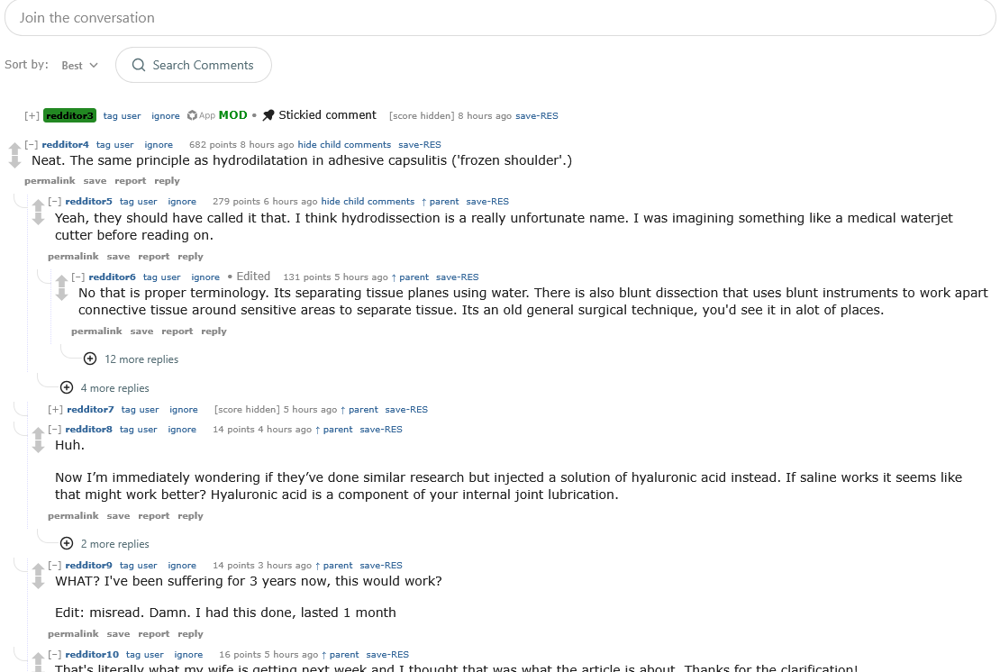
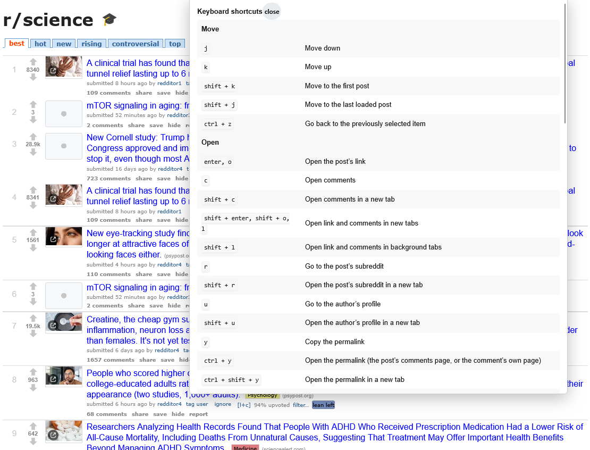

<p align="center">
  
</p>

<h1 align="center">REScue</h1>

<p align="center">
  <strong>Reddit Enhancement Suite, rescued for modern Reddit.</strong><br>
  Filters, keyboard navigation, user tags, comment tools, an Old Reddit look, and more,
  on today's www.reddit.com and sh.reddit.com, in Chrome and Firefox.
</p>

<p align="center">
  <a href="https://chromewebstore.google.com/detail/rescue-for-reddit/ddjbmknckcglmfohabaicadgeddpghbh"><strong>Get it for Chrome</strong></a>
</p>

---

Reddit Enhancement Suite (RES) made Reddit better for over a decade, but it was written for
old.reddit.com, and on today's Reddit it does nothing. REScue brings its useful parts back to the
Reddit you actually get now: the same ideas, rebuilt from scratch for Reddit's current page.

REScue **adds to Reddit's own page and never replaces it**. When Reddit changes something, Reddit
keeps working, and the REScue feature that depended on it switches itself off with a notice
instead of breaking the page.

## Highlights

- **Old Reddit look** (opt-in): feeds, search and comment threads restyled like old.reddit.com.
  You get the vote column with rank numbers, small thumbnails, blue titles with `(domain)`,
  "submitted 2 hours ago by user to r/sub", the flat `comments share save hide report` row, sort
  tabs, green pinned posts, thumbnails that open the link, the thin subreddit bar across the top,
  and old-style comment heads with a `*` after an edited comment's age. It appears from the first paint, with no flash of the new design,
  and REScue starts while Reddit is still sending the page. Every vote and button press goes
  through Reddit's own controls.
- **filteReddit**: hide posts by keyword, subreddit, domain, user, flair or NSFW, and collapse or
  hide comments by keyword, user, score or depth. A banner says what was hidden and lets you reveal
  it.
- **Low-effort reply filter** (on by default): replies that only agree, such as "This!", "100%",
  "I agree", "Exactly" or "+1", are collapsed, with the replies under them left visible. Questions,
  longer comments and picture-only comments are never caught. Switch it to hide, or off, in
  filteReddit.
- **Neutrality filter** (opt-in): an optional chip on each news link showing who shares that
  domain, coloured from blue (left-leaning audience) through grey to red (right-leaning audience).
  You can also hide far-left and far-right domains, with separate strictness for each side. Scores
  come from two published, CC0-licensed research datasets bundled with the extension. Nothing is
  looked up online.
- **Keyboard navigation**: `j`/`k` to move between posts and comments, `Enter` to open, `a`/`z` to
  vote, `s` to save, `h` to hide, go-to shortcuts, a command line, and a `?` help overlay.
- **User tagger**: tag, colour and ignore users, with an *ignore* button on posts and comments and a
  vote tally.
- **Comment tools**: macros and a big Markdown editor with a preview above the reply box, "show
  source" for a post's or comment's raw Markdown, a comment navigator, remembered collapsed
  comments, hiding child comments, "show parent" previews, sortable tables, comments saved on your
  device, a new-comment count and thread subscriptions.
- **Feed tools**: auto-hide read posts, hide promoted posts, hide "Suggested communities", pause
  endless scrolling (or load the next page sooner), wheel browsing, a media viewer,
  inline-media hiding, and media keys for the selected post (`[` and `]` step a gallery, `m` mutes
  a video, plus RES's image size and move keys).
- **Night mode**: always dark, always light, or follow Reddit's own switch.
- **Shortcut bar** across the top with your subreddits, plus "mail ▾" and "feeds ▾" menus for your
  inbox and custom feeds.
- **Settings console** with search, presets, quick toggles, a troubleshooter, and backup, restore
  and **import from a RES backup** (your user tags and filters come with you).

There are about 65 modules in all, grouped as **listings, comments, users, actions, appearance and
core** in the settings console. Each has a plain-language description and per-option explanations.

## Screenshots

<p align="center">
  
  <br><em>The Old Reddit look on r/science, with REScue's tag and ignore words and the neutrality chips.</em>
</p>

<p align="center">
  
  <br><em>Comment threads: old-style comment heads and link rows, "hide child comments" and "↑ parent".</em>
</p>

<table>
  <tr>
    <td width="45%"></td>
    <td></td>
  </tr>
  <tr>
    <td><em>Without the Old Reddit look: REScue adds its words to Reddit's own layout.</em></td>
    <td><em>Press <code>?</code> for every keyboard shortcut.</em></td>
  </tr>
</table>

Screenshots are taken signed out, and other people's usernames are replaced with placeholders.

## Install

**From the stores:**

- **Chrome, Edge or Brave:** [REScue for Reddit on the Chrome Web Store](https://chromewebstore.google.com/detail/rescue-for-reddit/ddjbmknckcglmfohabaicadgeddpghbh).
- **Firefox:** submitted to Firefox Add-ons; the link will follow once it is approved.

**From a release:** download `rescue-<version>-chrome.zip` from
[Releases](https://github.com/BaconWappedBitcoin/REScue/releases), unzip it, and load the folder
in Chrome as described below.

**From source** (Node 22 or newer):

```bash
git clone https://github.com/BaconWappedBitcoin/REScue.git
cd REScue
npm ci
npm run build            # Chrome:  .output/chrome-mv3/
npm run build:firefox    # Firefox: .output/firefox-mv3/
```

- **Chrome, Edge or Brave:** open `chrome://extensions`, turn on *Developer mode*, click *Load
  unpacked*, and choose `.output/chrome-mv3`.
- **Firefox or LibreWolf:** open `about:debugging#/runtime/this-firefox`, click *Load Temporary
  Add-on*, and choose `.output/firefox-mv3/manifest.json`. Firefox removes temporary add-ons when
  it restarts.

Then open Reddit. The **REScue** button in Reddit's header opens the menu and the settings console.

## Compared with Reddit Enhancement Suite

RES was written for old.reddit.com. Some of what it did, modern Reddit now does itself. Some of it
can't work any more, because the parts of Reddit it relied on no longer exist. REScue rebuilds the
rest.

The project's own audit checks every RES option and control, 707 in all:

| | Options | What it means |
|---|---:|---|
| **In REScue** | 394 | Works on modern Reddit. |
| **Partly** | 82 | The main behaviour works; details differ (each one is noted in the audit). |
| **Reddit does it** | 47 | Modern Reddit has its own version, so REScue doesn't duplicate it. |
| **Obsolete** | 132 | The Reddit feature it changed is gone (old Reddit's sidebar, per-subreddit CSS, `?depth=` links and so on). |
| **Not yet** | 52 | Possible, but each needs a workaround that hasn't been built yet. |

By RES module:

| RES module | REScue |
|---|---|
| **Settings, backup and restore, presets, command line, troubleshooter** | In REScue. Backup is a file you keep, or your browser's own sync; there is no Dropbox or Google Drive. Your RES backup's tags and filters can be imported. |
| **filteReddit** | In REScue: keywords, subreddits, domains, users, flair and NSFW for posts; keyword, user, score and depth for comments; each with a reason and a way to reveal it. |
| **Keyboard navigation** | In REScue: `j`/`k`, open, vote, save, hide, go-to keys and the help overlay. Voting on comments from the keyboard works through Reddit's own buttons. |
| **User tagger, user highlight** | In REScue: tags, colours, ignore (now with an ignore button), vote tally, and highlights for moderators, friends and tagged users. |
| **Comment navigator, hide child comments, show parent, remember collapsed comments, new comment count, saved comments, table tools** | In REScue. |
| **Comment tools (macros, big editor), view source, message menu, multireddit bar** | In REScue: macros and a big Markdown editor with a preview above the reply box, "source" for raw Markdown, and "mail ▾" and "feeds ▾" menus on the shortcut bar. |
| **Night mode** | In REScue: always dark, always light, or follow Reddit's own switch (Reddit's switch still works too). |
| **Never-ending Reddit** | Reddit scrolls endlessly by itself. REScue adds RES's pause, "load more" and "pause after N pages", and can load the next page sooner. |
| **Inline images and expandos (showImages)** | Reddit shows media inline itself. REScue adds hiding media in comments, a media viewer, and blocking media downloads. |
| **Subreddit shortcut bar, subreddit tagger, logo link, search helper, local date, custom CSS, style tweaks, username hider, page navigator** | In REScue, adapted to Reddit's current page. Some are partial where Reddit keeps an element out of reach. |
| **Auto-hide read posts, single click, cross-post links, wheel browse, quarantine notice, vote enhancements** | In REScue. |
| **Show karma, penalty box, dashboard** | Partly. |
| **Spoiler tags, hover cards, "more replies"** | Reddit does these itself. |
| **Comment depth, context links, per-subreddit styles, account switcher, report-as-spam** | Obsolete or excluded. Reddit ignores `?depth=` and `?context=`, has no subreddit CSS, and switches accounts itself. RES's account switcher stored passwords, which REScue never does. |
| **Submit helper, mod helper** | Not yet. |

**REScue extras** that RES never had: the Old Reddit look, the neutrality filter, the low-effort
reply filter, hiding promoted posts and "Suggested communities", an ignore button on posts and
comments, a front-page sort, and loading the next page sooner.

The full option-by-option audit is in
[`specs/001-rescue-foundation/res-option-parity.md`](specs/001-rescue-foundation/res-option-parity.md),
and the module-level matrix is in
[`feature-matrix.md`](specs/001-rescue-foundation/feature-matrix.md).

## Privacy

REScue has **no accounts, no analytics, no telemetry and no servers**.

- Your settings, tags, filters and history stay in your browser's extension storage. If you turn on
  browser sync, your settings are copied to your browser's own sync.
- Its own network access is limited, in code, to read-only requests to the Reddit page you are on,
  only for the few features that need them.
- It never sees, stores or sends your password or tokens.

Votes, saves, hides and reports are done by pressing Reddit's own buttons, so Reddit's page makes
those requests with your own session, exactly as if you had clicked. The details, including every
address REScue may read, are in the [privacy policy](PRIVACY.md).

## How it works

- **Selectors in one place.** Everything REScue reads from Reddit's page is named in
  [`src/contracts/reddit.ts`](src/contracts/reddit.ts). Each entry is marked *verified* (checked
  against the live site, with a date) or *candidate*, and features check their contracts at
  startup.
- **Read-only toward Reddit's internals.** REScue reads Reddit's open shadow roots but never
  writes into them. Actions press Reddit's own controls and are confirmed by what Reddit's buttons
  show afterwards.
- **Opt-in for anything that changes Reddit's look or hides content.** Skins, hiding and filters
  are off until you turn them on, and every hidden item can be revealed. The one exception is the
  low-effort reply filter, which only collapses agreement-only replies and can be switched off.
- **Starts early.** REScue starts as soon as the header, your sign-in and the first post are on the
  page, rather than when Reddit has sent all of it, and its features start side by side.

## Development

```bash
npm ci
npm run dev             # WXT dev mode
npm test                # unit tests (Vitest, about 1,650)
npx playwright test     # browser tests against fixture pages (about 295)
npm run lint
npx tsc --noEmit
npm run zip             # store packages in .output/
```

The code is TypeScript in strict mode, built with [WXT](https://wxt.dev) for Manifest V3. The
settings console is written in Preact. The specification, plan and the full RES feature-parity
matrix are in [`specs/001-rescue-foundation/`](specs/001-rescue-foundation/).

Bug reports are welcome: open an [issue](https://github.com/BaconWappedBitcoin/REScue/issues).
Please include your browser, the page address, and what you expected to happen. The settings
console's *Troubleshooter* can copy a diagnostics report for you.

## Credits

- [Reddit Enhancement Suite](https://github.com/honestbleeps/Reddit-Enhancement-Suite), by the RES
  contributors (GPL-3.0). It is the inspiration, and where a file ports logic from RES, its header
  says so.
- [Sheddit](https://github.com/kookaburrabarrel/sheddit), by kookaburrabarrel (GPL-3.0).
- The neutrality data:
  - Eady, Bonneau, Tucker and Nagler (2025), *News Sharing on Social Media*, Political Analysis.
    Data doi:10.7910/DVN/1QMLOV, CC0.
  - Robertson et al. (2018), *Partisan Bias Scores for Web Domains*. Data doi:10.7910/DVN/QAN5VX,
    CC0.

The full attribution is in [`NOTICE`](NOTICE).

## Donate

REScue is free and always will be. If you would like to support it:

- Bitcoin: `bc1que3qguxlvg0gkp4yqn6dju82rvqq5rmdaylj27`
- Ethereum: `0x23c46670511FfF3497A11f3ebbcdAc244b91F794`

The same addresses are in the add-on under settings › About REScue. Check the address you paste
into your wallet against one of these two places before you send.

## License

[GPL-3.0-or-later](LICENSE).

REScue is an independent open-source project. It is not made by, endorsed by, or affiliated with
Reddit, Inc. or the authors of Reddit Enhancement Suite. "Reddit" is a trademark of Reddit, Inc.,
and is used here only to describe what the extension works with.
